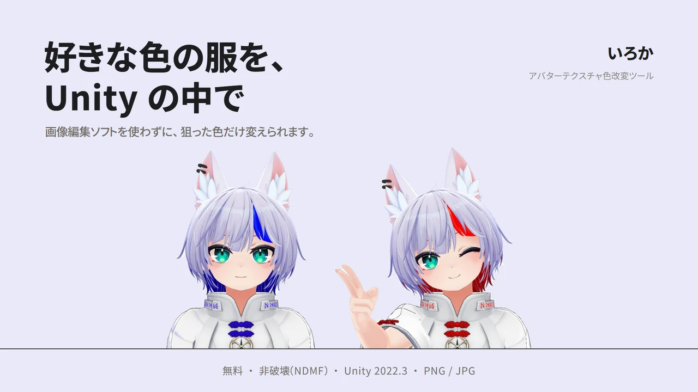

# Iroca/いろか Ver 0.2.0 (Beta)

Iroca/いろか は、Unity Editor 上でテクスチャの色を直感的に変更できる拡張ツールです。VRChat アバターのテクスチャ編集を主な対象としていますが、一般的な Unity プロジェクトでも使用できます。

▶ [紹介動画（1 分 33 秒・YouTube）](https://youtu.be/X1nqFYiOFoQ) / [Intro video (1:33, Japanese captions)](https://youtu.be/X1nqFYiOFoQ)  
画像と動画のアバター / Avatar: かなリぁ「[ハオラン-HAOLAN](https://booth.pm/ja/items/3818504)」

[日本語](#日本語) | [English](#english)

> **注：** 日本語版が公式版です。英語版は参考情報としてご利用ください。
> **Note:** The Japanese version is the official version. The English version is for reference only.

---

## 日本語

### 主な特徴

- **無料**: 基本的に無料で利用できます（投げ銭は歓迎しますが、任意です）
- **PSD がないテクスチャ向け**: 1 枚の PNG テクスチャを色改変したい場合に便利です
- **結合されたテクスチャも対応**: ブラシで保護エリアを描けるため、複数パーツが 1 枚にまとまっていても使用できます
- **高精度な処理**: 陰影や細部も正確に変更できます
- **3Dモデルに依存しない**: UV情報などに依存せず、テクスチャ単体で使用できます

### 動作環境（検証済み）

- **Unity 2022.3.22f1**（Windows で検証しています）
- VCC や VRChat SDK は不要です（Unity Editor 単体で動作します）
- 非破壊の色替えには NDMF 1.8 以上を使います。インストーラで入れると一緒に入ります（VCC / ALCOM の場合は[インストール手順](#インストール手順)を参照）。NDMF が無くても、画像の書き出しは使えます
- 自動調整と AI マスク提案には、Unity Sentis 2.1.3（Unity 2022.3.11f1 以降）と AI モデル（約 44 MB）が必要です。ウィンドウ上部の案内から導入できます
- 4096×4096 までのテクスチャで検証しています

### クイックスタート

1. [Releases](https://github.com/yukkuri-aoba/Iroca/releases) から `Iroca_v<バージョン>.zip` をダウンロードして展開し、中の `Iroca_Installer.unitypackage` を Unity Editor のプロジェクトウィンドウにドラッグ＆ドロップして「Import」をクリックします
2. 確認ダイアログで「Install」をクリックすると、最新版がダウンロードされて入ります（VCC / ALCOM からも導入できます。[インストール手順](#インストール手順)）
3. `Tools > いろか` からウィンドウを開きます
4. テクスチャを選び、「スポイトで変えたい色を選ぶ」を押してプレビュー上の色をクリックし、「変更先カラー」で新しい色を決めます
5. 「アバターに非破壊で登録」で、アバターに色替えを登録します（元のテクスチャは書き換えず、再生・アップロードのときだけ色替えされます）。画像ファイルとして保存したいときは「テクスチャとして書き出す」を開いて「適用して保存」を押します

詳しい使い方は **[オンラインマニュアル](https://yukkuri-aoba.github.io/Iroca/manual/)** にまとめています。
いろかウィンドウ上部の「マニュアル」からも開けます。

### 主な機能

#### 色改変
- テクスチャの特定部分を指定して色を変更します（カラーゾーン）
- 色替え対象は、プレビュー上の変えたい色をスポイトでクリックして指定します（カラーピック）
- 自動調整：スポイトしたパーツを AI 提案で解析し、暗部からハイライトまで覆うように許容範囲などを自動で合わせます
- 複数ゾーンが重なる部分の優先度は、ゾーンリストの並び順（`☰` ハンドルをドラッグ）で制御します

#### 境界処理
- エッジぼかし・縁のドット回収・境界クリーンアップに対応します
(元のテクスチャを壊さず、誤った部分を変換しないための仕組みです)

#### マスク（除外・含める）
- プレビュー上でブラシを使って、色改変しない領域（除外）と必ず色改変する領域（含める）を指定します
- 除外は全ゾーン共通と各ゾーン専用の 2 種類を使い分けられます
- Unity 標準の Undo（Ctrl+Z）に対応しています
- 右クリックメニュー：プレビューを右クリックして、AI 提案やパーツ（メッシュの UV の島）単位でマスクへ追加します
  - AI マスク提案（実験的）：AI が領域を推定してマスクへ追加します。1 回で取れるのはつながった 1 領域なので、分かれたパーツは島ごとに繰り返します（Unity Sentis + MobileSAM）
  - パーツ：テクスチャを使うメッシュが見つかると、UV の島やメッシュ単位で追加できます。色では分けられない同じ色の別パーツを分けられます（メッシュが無ければ従来どおり）
  - 使っているメッシュはマスク欄の「メッシュ」に出ます。FBX・Prefab をドラッグして指定でき、UV の島の輪郭をプレビューに重ねて表示できます
- Scene でクリックした場所の表示：Scene でモデルをクリックすると、その部分がテクスチャのどこにあるかをプレビューに示します（テクスチャを開いていなければ、そのテクスチャを開きます）

#### 非破壊で色替え（NDMF）
- 元のテクスチャとマテリアルを書き換えずに色替えできます。「アバターに非破壊で登録」でアバターや衣装に「Iroca Recolor」が付き、再生・アップロードのときだけ色替え済みのテクスチャに差し替わります。外せば元に戻ります
- 再生しなくても、シーンのアバターに色替えが映ります（NDMF のプレビュー）。いろかで設定を動かすとアバターも追従し、登録前のテクスチャでも試せます

#### その他
- プレビュー：ズーム（Ctrl+スクロール・リセット）・前後比較・差分表示・押している間だけ元画像を表示
- ゾーンのソロ表示：1 つのゾーンだけをプレビューして、どこを拾っているか確かめられます
- 操作モードの表示：プレビュー上のクリックが何をするかを 1 行で表示し、Esc で解除できます
- プリセット：設定とマスクの保存・読み込み、JSON での書き出し・読み込み対応
- 日本語・英語の自動切り替え

### 向いているケース

- 陰影がはっきりしたテクスチャ
- 単純なベタ塗りのテクスチャ

### あまり向かないケース

- 色の似た部分が多いテクスチャ
- 色のグラデーションが複雑なテクスチャ
- 反射や光沢の強いテクスチャ

これらのケースでも、マニュアルの「困ったとき」で対策を紹介しています。

### インストール手順

次のどちらかで導入します。どちらも、いろかは Unity の `Packages` に入ります。

**インストーラ（unitypackage）から**

1. [Releases](https://github.com/yukkuri-aoba/Iroca/releases) から `Iroca_v<バージョン>.zip` をダウンロードして展開します（中身はインストーラ `Iroca_Installer.unitypackage`・README.txt・LICENSE.txt です。同じ欄の `com.yukkuri-aoba.iroca-<バージョン>.zip` は VCC / ALCOM が取得するパッケージ本体なので、ダウンロードする必要はありません）
2. `Iroca_Installer.unitypackage` を Unity Editor にドラッグ＆ドロップし、ダイアログで「Import」をクリックします
3. 確認ダイアログで「Install」をクリックすると、最新版がダウンロードされて入ります（インターネット接続が必要です。インストーラ自体は自動で消えます）

**VCC / ALCOM から**

1. VCC（または ALCOM）の設定で、リポジトリ `https://yukkuri-aoba.github.io/Iroca/index.json` を追加します
2. プロジェクトの管理画面で「いろか」と「Non-Destructive Modular Framework」（NDMF）を追加します。NDMF もこのリポジトリに載っています

入ったら `Tools > いろか` からウィンドウを開きます。

### ライセンス

[PolyForm Shield License 1.0.0](LICENSE)

- 個人・商用を問わず自由に使用できます
- 本ツールと競合する製品・サービスの開発・提供に使用することは禁止されています
- 改変および再配布は自由に許可されています（競合製品への使用を除く）
- 各規約・ガイドラインに従った使用は利用者の責任です

---

## English

### Key Features

- **Free**: Free to use at its core (tips welcome, purchase optional)
- **For textures without a PSD**: Great when you just want to recolor a single PNG texture
- **Works with merged textures**: The exclusion mask brush makes it easy to isolate parts even when multiple elements share one texture
- **High-precision algorithm**: Accurate recoloring with fine details preserved
- **Independent of 3D models**: Works on textures alone, without relying on UV information or other model data

### Requirements

- **Unity 2022.3.22f1** (tested on Windows)
- No VCC / VRCSDK required (works standalone in Unity Editor)
- Non-destructive recoloring uses NDMF 1.8 or later. The installer installs it together with Iroca (for VCC / ALCOM, see [Installation](#installation)). Without NDMF, exporting images still works
- Auto-tune and AI Mask Suggestion need Unity Sentis 2.1.3 (Unity 2022.3.11f1 or later) and the AI models (about 44 MB). You can install them from the notice at the top of the window
- Tested with textures up to 4096×4096

### Quick Start

1. Download `Iroca_v<version>.zip` from [Releases](https://github.com/yukkuri-aoba/Iroca/releases), extract it, import `Iroca_Installer.unitypackage` into Unity Editor, and click "Install" in the confirmation dialog (or add it via VCC / ALCOM; see [Installation](#installation))
2. Open the window: `Tools > いろか`
3. Select a texture, press "Pick the color to change" and click that color on the preview, then choose the new color in "Target Color"
4. Click `Register to avatar (non-destructive)` (the original texture is kept; the recoloring happens only when entering Play mode or uploading). To save an image file instead, open `Export as a texture` and click `Apply & Save`

See the **[online manual](https://yukkuri-aoba.github.io/Iroca/manual/)** for detailed instructions
(the `Manual` button at the top of the Iroca window opens it in your browser).
The manual is in Japanese for now; an English version will follow.

### Main Features

#### Recoloring
- Target specific texture areas and change their color (Color Zones)
- Select the color to replace by picking it directly on the preview (Color Pick)
- Auto-tune: analyzes the picked part with the AI suggestion and sets the tolerance and related settings to cover it from shadows to highlights
- Control priority across overlapping zones by their order in the zone list (drag the `☰` handle to reorder)

#### Boundary Processing
- Edge Feather / AA Edge Cleanup / Edge Decontamination for smooth color transitions

#### Masks (Exclude / Include)
- Paint the areas to protect (Exclude) and the areas to always recolor (Include) directly on the preview
- Exclude supports both a common mask and per-zone masks
- Integrated with Unity's standard Undo (Ctrl+Z)
- Right-click menu: right-click the preview to add an AI-suggested region or a mesh part (UV island) to a mask
  - AI Mask Suggestion (experimental): the AI estimates the region and adds it to the mask. One use picks one connected region, so repeat for each island of a split part (Unity Sentis + MobileSAM)
  - Parts: when a mesh using the texture is found, add whole UV islands or meshes. This separates same-colored parts that color alone cannot split (without a mesh, everything works as before)
  - The meshes in use are shown in the "Mesh" field of the mask section. Drag an FBX or prefab there to choose one, and overlay the UV island outlines on the preview
- Show the spot you click in the Scene: click the model in the Scene view to see where that part is on the texture (if no texture is open, the texture of that part is opened)

#### Non-destructive recoloring (NDMF)
- Recolor without changing the original texture or materials. "Register to avatar (non-destructive)" adds "Iroca Recolor" to the avatar or outfit, and the recolored texture is swapped in only when entering Play mode or uploading. Remove it to go back
- See the recoloring on the avatar in the Scene without entering Play mode (NDMF preview). The avatar follows as you change settings in Iroca, even for textures not registered yet

#### Other
- Preview: zoom (Ctrl+Scroll and Reset), before/after comparison, diff view, hold a button to see the original
- Solo a zone: preview a single zone to check what it selects
- Current mode row: one line showing what a click on the preview does, with Esc to leave the mode
- Presets: save and load settings with masks, JSON export/import
- Auto language detection (Japanese / English)

### Best Use Cases

- Textures with clear, well-defined shading
- Textures with simple flat colors

### Limitations

- Textures with many similarly-colored areas
- Textures with complex color gradients
- Textures with reflections or specular highlights

The manual's troubleshooting chapter covers workarounds and tips.

### Installation

Use either method. Both install Iroca into your project's `Packages`.

**From the installer (unitypackage)**

1. Download `Iroca_v<version>.zip` from [Releases](https://github.com/yukkuri-aoba/Iroca/releases) and extract it (it contains the installer `Iroca_Installer.unitypackage`, README.txt and LICENSE.txt; the `com.yukkuri-aoba.iroca-<version>.zip` in the same list is the package that VCC / ALCOM download, so you don't need it)
2. In Unity Editor, select `Assets > Import Package > Custom Package...`, choose `Iroca_Installer.unitypackage`, and click "Import"
3. Click "Install" in the confirmation dialog. The latest version is downloaded and installed (requires an internet connection; the installer removes itself)

**From VCC / ALCOM**

1. In VCC (or ALCOM) settings, add the repository `https://yukkuri-aoba.github.io/Iroca/index.json`
2. Add "いろか" and "Non-Destructive Modular Framework" (NDMF) from your project's management screen. NDMF is also listed in this repository

Then open the window via `Tools > いろか`.

### License

[PolyForm Shield License 1.0.0](LICENSE)

- Free to use for personal and commercial purposes.
- Cannot be used to provide a product that competes with this software.
- Modification and redistribution are freely permitted (except for competing products).
- Use in accordance with each license and guideline is the responsibility of the user.

---

## クレジット / Credits

開発者・AI 補助・AI マスク提案のモデル（MobileSAM）・アルゴリズムの開発に使用させていただいたモデルとテクスチャ・サードパーティの一覧は、[CREDITS.md](CREDITS.md) にまとめています。
いろかのウィンドウ右上の「クレジット」からも開けます。

Developer, AI assistance, the AI mask model (MobileSAM), the avatar and outfit data used to develop the algorithms, and third-party notices are listed in [CREDITS.md](CREDITS.md). You can also open it from the "Credit" button in the Iroca window.

Copyright (c) 2026 yukkuri__aoba  
Licensed under [PolyForm Shield License 1.0.0](LICENSE)

### 連絡先 / Contact

- Misskey.io: [@yukkuri__aoba@misskey.io](https://misskey.io/@yukkuri__aoba)
